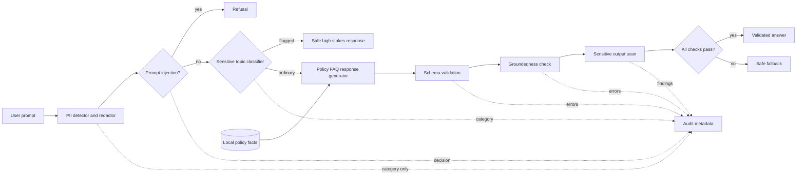

# Architecture

## Stage decisions

1. **PII scan/redaction runs first** so subsequent stages and the deterministic generator operate on masked text. The demo reports PII kinds, never matched values.
2. **Injection and topic checks precede generation** so flagged requests cannot reach the answer path. Injection attempts are refused. Medical and financial requests receive a professional-referral message; self-harm gets a brief crisis direction; violent requests are refused.
3. **The response generator reads only local policy facts** about returns, shipping, and refunds. Unsupported questions receive a fallback.
4. **Output validators run last** because schema, groundedness, and leakage checks must inspect the final candidate. Any validation error fails closed to the same safe fallback.

The audit metadata is returned to the caller for demonstration and is designed not to contain prompt text or PII values. A real service would also need access controls, retention limits, tamper-evident storage, and monitoring.
